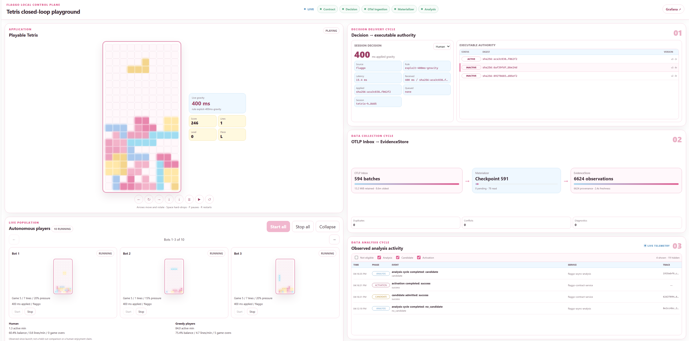

# Flaggo

**An evidence-driven control plane for runtime decisions, with asynchronous AI
learning and deterministic online evaluation.**

Making a configuration configurable is only the first step. Improving it
usually requires a separate loop: collect telemetry, analyze outcomes, choose
a change, and roll it out. Those steps often span tools and teams, leaving
runtime behavior configurable but manually optimized.

Flaggo explores closing that loop for selected runtime decisions. Teams define
a versioned decision contract: its inputs, valid outputs, objectives, and
guardrails. Applications request decisions and retain ownership of applying
them. Asynchronous analysis uses decision receipts and application telemetry
to propose new executables, which must pass validation and activation before
influencing runtime behavior.

**AI proposes the behavior; deterministic executables serve runtime requests.**
The online path does not invoke an LLM or wait for analysis. It evaluates the
immutable executable active for the requested contract version.

## How the loop works

```text
Define a decision contract
          |
          v
Evaluate the active executable --> Application applies the result
          ^                                  |
          |                                  v
Validate and activate <-- Agent proposes <-- Analyze observed outcomes
```

Decision contracts make the delegated interface and intent explicit.
Immutable executable identities make behavior traceable. Activation is the
only transition that grants runtime authority: generating a Candidate does
not make it active, and analysis cannot write runtime authority directly.

The current stack supports contract deployment, authored executables,
deterministic evaluation, telemetry ingestion, evidence materialization,
asynchronous Copilot analysis, Candidate admission, and auto-activation.
The live learning loop proposes testable changes; it does not guarantee
improvement or prove that observed outcomes transfer to every future context.

## Where Flaggo fits

Flaggo is for contextual, high-change runtime choices where explicit contracts,
observable outcomes, and governed activation are better than fixed thresholds
or manually operated configuration. Feature-flag and configuration-like
decisions are one application of this model, not its entire purpose.

It is not a general-purpose agent task runner, an LLM call on every request,
or a replacement for application execution. Not every branch should become
a decision call, and not every decision needs AI. The application still owns
what happens after receiving a result.

## Try the playground



*Flaggo in action: human and autonomous gameplay produce evidence;
asynchronous analysis proposes decision executables, which gain runtime
authority after validation and activation. Tetris demonstrates the control
loop, not a proven optimal policy.*

Run the browser playground to play Tetris and observe a complete local
decision/evidence/analysis/activation loop. Tetris demonstrates the architecture;
it is not the product boundary.

Prepare the [Python analysis environment](examples/README.md#python-environment-for-live-analysis)
first. From the repository root, configure BYOK with an OpenAI-compatible
endpoint and launch the playground:

```powershell
npm ci
dotnet restore Flaggo.slnx --configfile NuGet.config

$env:FLAGGO_ANALYSIS_INFERENCE = "byok"
$env:FLAGGO_ANALYSIS_BYOK_WIRE_API = "responses"
$env:FLAGGO_ANALYSIS_MODEL = "<model-or-deployment-name>"
$env:OPENAI_BASE_URL = "<openai-compatible-api-base-url>"
$env:OPENAI_API_KEY = [System.Net.NetworkCredential]::new(
    "", (Read-Host "Provider API key" -AsSecureString)
).Password

npm run tetris:playground
```

Set your provider's full API base URL and model (or deployment name), and run
in the same terminal. Never commit your API key. BYOK uses the Copilot
SDK/runtime without GitHub authentication or fallback.

See [inference configuration](examples/README.md#inference-for-live-analysis)
for protocol options and the GitHub-backed alternative (`GH_TOKEN` or
`GITHUB_TOKEN`), or the [BYOK guide](apps/async-analysis/README.md#byok-inference)
for supported endpoints, credential limits, and validation status.

Play the human game alongside ten autonomous greedy-player
slots, with three bot sessions visible at a time. Use `--mode=benchmark` for the separate credential-free,
deterministic controlled comparison. The launcher starts pinned Collector and
Grafana LGTM containers plus all real Flaggo services and prints dynamic
loopback URLs. See the
[playground guide](examples/tetris-playground/README.md) for the telemetry
boundary, Copilot mode, retained diagnostics, and verification workflow.

For a terminal integration, see the
[interactive Tetris guide](examples/tetris-integration/README.md).

## Learn more

- [Manifesto](docs/MANIFESTO.md): purpose, principles, and product boundaries
- [Documentation home](docs/README.md): product and technical guides
- [Architecture overview](docs/design/architecture/OVERVIEW.md)
- [Application boundaries and lifecycle](docs/design/architecture/APP_BOUNDARIES.md)
- [Project roadmap](https://github.com/users/hahahahahaiyiwen/projects/3)
- [Contributing](CONTRIBUTING.md): development and verification

## Repository layout

```text
apps/          Runnable application composition roots
modules/       Internal business capabilities and owned ports
packages/      Reusable SDK and data-contract packages
contracts/     OpenAPI, JSON Schema, OTel profiles, fixtures, and conformance
tests/         Cross-module and end-to-end verification
examples/      Integrations and showcase links
deploy/        Fixture-container assets; production service topology is deferred
tools/         Repository development commands
docs/          Product, architecture, scenarios, and boundary designs
```

Logical architecture is defined by service and store ownership, not by the
current assembly count. Prefer the smallest complete end-to-end behavior over
speculative platform breadth.
